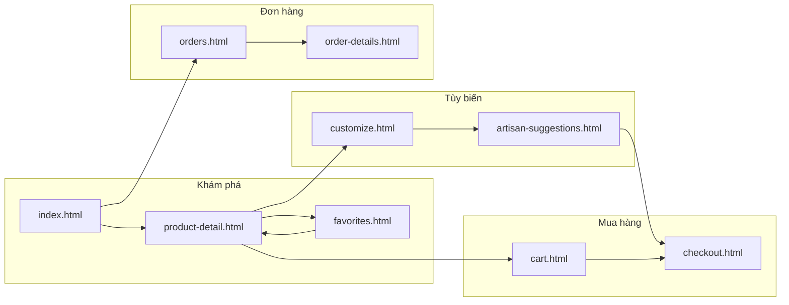
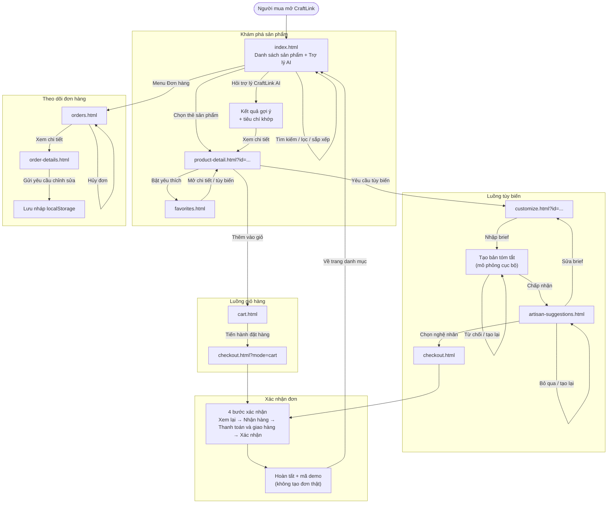

# DOC — CraftLink (Buyer)

> Tài liệu tổng hợp phía **người mua** trong thư mục `KhachHang/`.
> Cập nhật: 2026-10-25.
>
> - README phân hệ: [`README.md`](README.md)
> - Phân công SV1 của nhóm: [`../docs/sv1-assignment.md`](../docs/sv1-assignment.md)
> - Bảng kiểm kê màn hình toàn dự án của nhóm: [`../docs/screen-inventory.md`](../docs/screen-inventory.md)

---

## 1. Tác nhân và phạm vi

- **Tác nhân duy nhất:** Người mua (Buyer).
- **Điểm vào:** `index.html`.
- **Dữ liệu:** 8 sản phẩm và 7 nghệ nhân mẫu trong `js/data.js`; không có backend, không gọi API.
- **Lưu trữ trình duyệt:**
  - `craftlink_cart` — giỏ hàng (localStorage).
  - `craftlink_favorites` — sản phẩm yêu thích (localStorage).
  - `craftlink_revision_draft` — nháp yêu cầu chỉnh sửa (localStorage).
  - `craftlink_checkout_draft` — nháp đơn tùy biến (sessionStorage).
  - `craftlink_cart_checkout_draft` — nháp đơn từ giỏ hàng (sessionStorage).

## 2. Sitemap

Ghi chú: header xuất hiện trên cả 9 trang và có liên kết nhanh tới Giỏ hàng, Yêu thích, Nghệ nhân và Đơn hàng. Sơ đồ trên chỉ vẽ các luồng nghiệp vụ chính để tránh rối.

## 3. User Flow chính

## 4. Các bước của luồng chính

### 4.1. Luồng tùy biến (happy path)

1. Người mua mở `index.html`, tìm kiếm hoặc lọc sản phẩm.
2. Chọn một sản phẩm để mở `product-detail.html?id=...`.
3. Bấm **Yêu cầu tùy biến** để sang `customize.html?id=...`.
4. Nhập mô tả, bấm **Tạo bản tóm tắt**, xem kết quả mô phỏng.
5. Chấp nhận brief để sang `artisan-suggestions.html`.
6. Xem gợi ý kèm lý do, chọn nghệ nhân để sang `checkout.html`.
7. Đi qua 4 bước: **Xem lại → Nhận hàng → Thanh toán và giao hàng → Xác nhận**.
8. Hệ thống hiển thị trạng thái hoàn tất và mã demo; không tạo đơn hàng thật.

### 4.2. Luồng mua từ giỏ hàng

1. Từ `product-detail.html`, bấm **Thêm vào giỏ hàng**.
2. Mở `cart.html`, tăng/giảm số lượng hoặc xóa sản phẩm.
3. Bấm **Tiến hành đặt hàng** để mở `checkout.html?mode=cart`.
4. Đi qua 4 bước xác nhận như luồng tùy biến.

### 4.3. Luồng yêu thích

1. Ở `product-detail.html`, bật trái tim để lưu sản phẩm.
2. Mở `favorites.html` để xem danh sách.
3. Bỏ yêu thích, mở lại chi tiết hoặc chuyển sang tạo brief.

### 4.4. Luồng đơn hàng

1. Mở `orders.html` từ menu.
2. Chuyển tab trạng thái, tìm kiếm hoặc lọc thời gian.
3. Bấm **Xem** để mở `order-details.html` (trang chi tiết đơn mẫu).
4. Nhập nội dung chỉnh sửa và gửi; nội dung chỉ được lưu nháp trong localStorage.
5. Có thể hủy đơn trên `orders.html`; thao tác chỉ đổi giao diện, không lưu vào đâu.

## 5. Ranh giới của bản demo

- **Không có đơn hàng thật:** xác nhận đơn chỉ ghi draft và mã demo vào sessionStorage.
- **Trang Đơn hàng độc lập:** `orders.html` dùng 4 dòng dữ liệu mẫu tĩnh; checkout không tạo thêm đơn và không có liên kết tự động sang `orders.html`.
- **Không có thanh toán:** chỉ chọn phương thức, không xử lý giao dịch.
- **Không có máy chủ:** không gửi brief, thông tin nhận hàng hay yêu cầu chỉnh sửa đến nghệ nhân.
- **AI là mô phỏng cục bộ:** trợ lý ở `index.html` và phần tóm tắt brief dùng luật từ khóa, không gọi mô hình AI.
- **Trang chi tiết đơn tĩnh:** `order-details.html` hiển thị một đơn mẫu cố định, không đọc `?id` để render đơn tương ứng.
- **Chưa kiểm thử lại sau khi chuyển thư mục:** mã nguồn được sao chép từ repo cá nhân vào `KhachHang/`; cần mở lại 9 trang và chạy luồng mua trước khi merge.

## 6. Minh chứng trong code

| Bước | File và hàm |
|---|---|
| Tìm kiếm, lọc, sắp xếp | `js/main.js` — `initProductList` (dòng 583), `applyCatalog` (dòng 740), `normalizeText` (dòng 571) |
| Trợ lý CraftLink AI | `js/ai-advisor.js` — `aiRunSearch` (dòng 1713), `aiSearchAll` (dòng 1096) |
| Chi tiết sản phẩm | `js/main.js` — `initProductDetail` (dòng 1008), `renderProductDetail` (dòng 831) |
| Tạo brief | `js/main.js` — `initCustomizePage` (dòng 1345), `runSummary` (dòng 1531) |
| Gợi ý nghệ nhân | `js/main.js` — `initArtisanSuggestionsPage` (dòng 1795), `renderCards` (dòng 2028) |
| Xác nhận đơn | `js/checkout.js` — `renderStep` (dòng 394), `handleConfirm` (dòng 510) |
| Đơn hàng | `js/main.js` — `initOrdersPage` (dòng 1640) |
| Chi tiết đơn | `js/main.js` — `initOrderDetailsPage` (dòng 1762) |

## 7. Phạm vi SV1 theo tài liệu nhóm

Tài liệu nhóm ghi vai trò SV1 là **“Khách hàng (Buyer) & Giao diện chung”**, phụ trách **6 màn hình**, kèm tính năng **“AI Personalization & Visual Matcher”** (`../README.md`, `../docs/team-assignment.md`). `../docs/screen-inventory.md` cũng xếp SV1 vào 6 màn hình TASK-01…TASK-06.

`../docs/sv1-assignment.md` mô tả thêm các phần chưa có trong thư mục này:

- Khung giao diện dùng chung (`navbar.css`, `footer.css`, `style.css`) và trang `403.html`, `404.html`.
- Luồng đăng nhập, đăng ký, quên mật khẩu.
- Trang hồ sơ cá nhân `pages/common/profile.html`.
- AI cá nhân hóa dựa trên lịch sử xem sản phẩm, từ khóa tìm kiếm và phong cách nghệ thuật.

Thực tế trong `KhachHang/`:

- Có 9 trang Buyer, không có trang đăng nhập/đăng ký/hồ sơ/403/404.
- Header và footer được viết trực tiếp trong từng trang, không có tệp layout dùng chung.
- Trợ lý AI chấm điểm theo từ khóa và tiêu chí minh bạch, không lưu lịch sử tương tác, không gọi mô hình AI.
- Trang đơn hàng dùng dữ liệu mẫu tĩnh.

Bảng đối chiếu chi tiết nằm ở [`README.md`](README.md) mục 6. PR này không sửa tài liệu nhóm; việc thống nhất 6 hay 9 màn hình cần nhóm quyết định trong một PR riêng.
