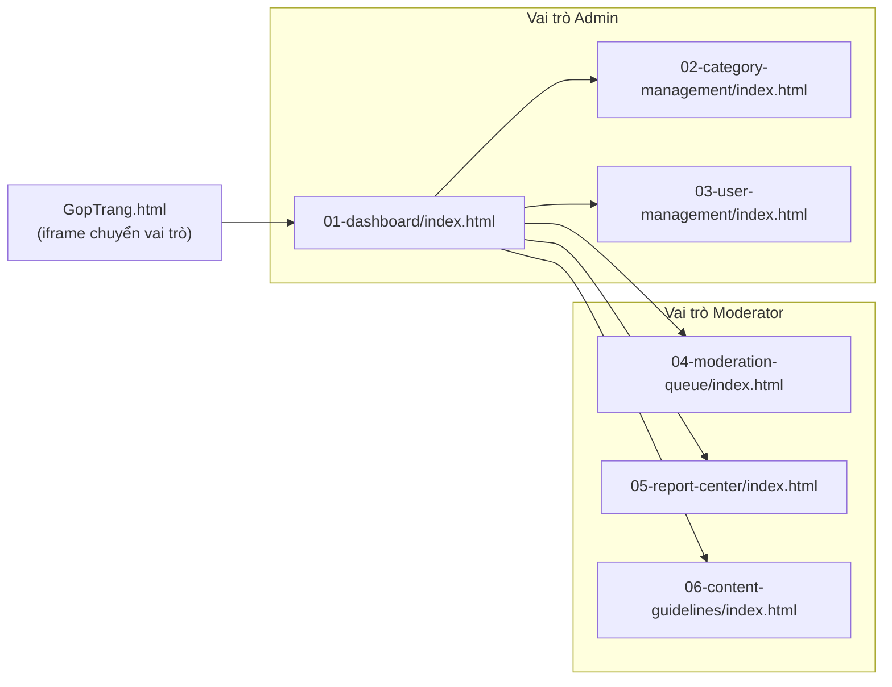
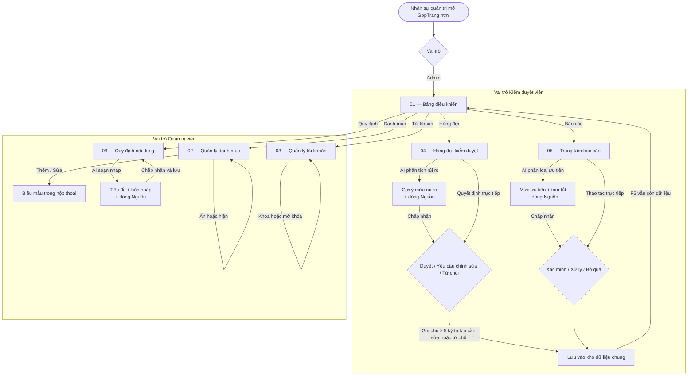

# DOC — CraftLink (Admin & Moderator)

> Tài liệu tổng hợp phía **quản trị và kiểm duyệt** trong thư mục `KiemDuyetVaQuanTri/`.
> Cập nhật: 2026-10-26.
>
> - README phân hệ: [`README.md`](README.md)
> - Phân công SV3 của nhóm: [`../docs/sv3-assignment.md`](../docs/sv3-assignment.md)
> - Bảng kiểm kê màn hình toàn dự án: [`../docs/screen-inventory.md`](../docs/screen-inventory.md)
> - Luồng người dùng (sơ đồ chung): [`../docs/user-flow.md`](../docs/user-flow.md)

---

## 1. Tác nhân và phạm vi

- **Hai tác nhân:**
  - **Quản trị viên (Admin)** — `01-dashboard`, `02-category-management`, `03-user-management`.
  - **Kiểm duyệt viên (Moderator)** — `04-moderation-queue`, `05-report-center`, `06-content-guidelines`.
- **Điểm vào:** `GopTrang.html` là khung chuyển vai trò, nạp sáu trang bằng `iframe`; mỗi trang cũng tự chạy độc lập khi mở `index.html` của thư mục con.
- **Dữ liệu:** năm tệp JSON trong `assets/data/` — `categories.json` 15 bản ghi, `guidelines.json` 15, `products.json` 20, `reports.json` 20, `users.json` 20.
- **Lưu trữ trình duyệt:**
  - Khóa chung: `craftlink:data:v1:<collection>` — do `js/api.js` sinh ra, dùng cho cả sáu màn.
  - Khóa cũ còn đọc được (dữ liệu của bản demo trước khi gộp):
    - `craftlink-slide02-categories-slide-v2` — danh mục.
    - `craftlink-slide03-users-v2` — tài khoản.
    - `craftlink-slide04-products-v2` — sản phẩm.
    - `craftlink-slide05-reports-v2` — báo cáo.
    - `craftlink-content-guidelines-v4` — quy định.

## 2. Sitemap

Ghi chú: điều hướng nằm ở `js/navigation.js`. Khi trang chạy trong `GopTrang.html`, mục menu gửi `postMessage({ type: "craftlink:navigate" })` để khung cha đổi `iframe` mà không tải lại cả trang; khi mở rời, cùng nút đó chuyển trang bằng `location.assign`.

## 3. User Flow chính

## 4. Các bước của luồng chính

### 4.1. Kiểm duyệt sản phẩm (04 — TASK-14)

1. Mở `04-moderation-queue/index.html`; mặc định lọc **Đang chờ**, sắp xếp **Mới nhất**.
2. Gõ vào ô tìm trên header (tên sản phẩm hoặc tên thợ) — danh sách lọc sau khi ngừng gõ 260 ms.
3. Bấm vào thẻ sản phẩm để mở hộp thoại chi tiết (ảnh, mô tả, giá, trạng thái).
4. Bấm **AI phân tích rủi ro** để nhận gợi ý; đọc dòng **Nguồn:** để biết kết quả đến từ mô hình hay từ bộ quy tắc cục bộ.
5. Chọn **Duyệt**, **Yêu cầu chỉnh sửa** hoặc **Từ chối**. Hai lựa chọn sau bắt buộc ghi chú ≥ 5 ký tự; thiếu thì lỗi hiện ngay dưới ô và ô được đánh dấu `aria-invalid`.
6. Xác nhận; trạng thái sản phẩm được ghi vào kho dữ liệu chung, danh sách và thẻ số liệu ở Dashboard cập nhật theo.
7. Nếu lọc bằng từ khóa không tồn tại, trang rơi vào **Empty state** — chỉ ở trạng thái này mới có nút **Khôi phục dữ liệu mẫu**.

### 4.2. Xử lý báo cáo (05 — TASK-15)

1. Mở `05-report-center/index.html`; bảng mặc định 10 dòng mỗi trang.
2. Lọc theo **trạng thái**, **lý do** và **khoảng thời gian** (7 hoặc 30 ngày); bấm tiêu đề cột để đổi sắp xếp.
3. Bấm **Xem** để mở chi tiết: người gửi, đối tượng, bằng chứng, hiệu lực xử lý.
4. Bấm **AI phân loại** để nhận mức ưu tiên và tóm tắt; chấp nhận gợi ý thì mức ưu tiên được ghi vào bản ghi báo cáo.
5. Chọn **Xác minh**, **Xử lý vi phạm** hoặc **Bỏ qua**. Hai thao tác sau hỏi xác nhận trước khi đổi trạng thái.
6. Đổi số dòng mỗi trang hoặc trang hiện tại; bộ lọc được đặt lại khi thao tác tìm kiếm thay đổi.

### 4.3. Quản lý danh mục (02 — TASK-16)

1. Mở `02-category-management/index.html`; bảng có năm cột: Danh mục, Số danh mục con, Tổng số sản phẩm, Trạng thái, Hành động.
2. Tìm theo tên, lọc theo trạng thái hiển thị, sắp xếp A–Z / Z–A / nhiều sản phẩm nhất.
3. Bấm **Thêm danh mục** hoặc **Sửa** để mở biểu mẫu trong hộp thoại.
4. Nhập tên (≥ 2 ký tự, không trùng), số danh mục con và số sản phẩm (số nguyên trong khoảng cho phép), chọn ảnh nền (JPG/PNG/WebP, ≤ 5 MB).
5. Lưu; danh mục mới hoặc bản sửa hiện ngay trong bảng và vẫn còn sau khi F5.
6. Bấm công tắc để ẩn/hiện, hoặc nút xóa (có hỏi xác nhận).

### 4.4. Quản lý tài khoản (03 — TASK-17)

1. Mở `03-user-management/index.html`.
2. Tìm theo tên hoặc email; chuyển tab vai trò **Tất cả / Khách hàng / Thợ thủ công / Kiểm duyệt viên** (tab dùng `aria-pressed`).
3. Bấm **Thêm tài khoản** hoặc **Sửa**; họ tên bắt buộc, email phải đúng định dạng và không trùng (so sánh không phân biệt hoa thường).
4. Bấm công tắc để **khóa** hoặc **mở khóa**; trạng thái đổi giữa *Hoạt động* và *Tạm dừng*.
5. Xóa tài khoản có hỏi xác nhận.

### 4.5. Quy định nội dung (06 — TASK-18)

1. Mở `06-content-guidelines/index.html`; bảng quy định nhóm theo chủ đề.
2. Tìm theo tên hoặc nội dung — ví dụ `kích thước` cho đúng một kết quả; lọc theo nhóm; sắp xếp A–Z / Z–A.
3. Bấm **Thêm quy định** hoặc **Sửa**; tên ≥ 2 ký tự và không trùng, nội dung ≥ 8 ký tự.
4. Bấm **AI soạn quy định** để nhận tiêu đề và bản nháp; sửa trực tiếp nếu cần rồi bấm **Chấp nhận và lưu** — chỉ khi đó bản ghi mới được ghi và đánh dấu *AI hỗ trợ*.
5. Xóa quy định có hỏi xác nhận.

### 4.6. Bảng điều khiển (01 — TASK-13)

1. Mở `01-dashboard/index.html`: bốn thẻ số liệu, biểu đồ tỷ lệ ngành hàng, nhật ký hoạt động.
2. Hai thẻ **Nghệ nhân đang hoạt động** và **Cảnh báo hệ thống** được tính từ kho dữ liệu chung khi trang tải và mỗi lần dữ liệu thay đổi; hai thẻ **Doanh thu** và **Đơn hàng**, cùng biểu đồ và nhật ký, là số liệu minh họa viết sẵn.
3. Gõ vào ô tìm trên header để lọc nhật ký theo thời gian, hành động hoặc người thực hiện.

## 5. Ranh giới của bản demo

- **Không có đăng nhập và không phân quyền thật:** vai trò chỉ thể hiện bằng `body class` (`admin` hoặc `moderator`), menu và ảnh đại diện; mở thẳng đường dẫn nào cũng vào được. Đăng nhập thuộc phần chung của nhóm (`DangNhapVaDangKy/`).
- **Không có máy chủ dữ liệu:** mọi thay đổi chỉ nằm trong `localStorage` của trình duyệt đang dùng, không đồng bộ giữa máy hay giữa người.
- **Dashboard chỉ minh họa một phần:** doanh thu, đơn hàng, biểu đồ và nhật ký là số liệu viết sẵn; chỉ hai thẻ nghệ nhân và cảnh báo là tính thật.
- **AI cần khóa ở máy chủ:** `api/ai.js` đọc `AI_API_URL`, `AI_API_KEY`, `AI_MODEL` từ biến môi trường. Chưa cấu hình thì `js/ai-fallback.js` trả lời bằng bộ quy tắc cục bộ và giao diện ghi rõ ở dòng **Nguồn:**.
- **AI không tự hành động:** không tự duyệt, không tự xóa, không khóa tài khoản, không đề xuất mức phạt, không phát hiện vi phạm bản quyền.
- **`product-discovery` chưa nối giao diện:** hàm có trong `js/ai-fallback.js` nhưng không màn nào gọi.
- **Không có nút đặt lại chung:** nút **Khôi phục dữ liệu mẫu** của hàng đợi kiểm duyệt chỉ hiện trong Empty state; muốn về dữ liệu gốc ở các màn khác thì xóa khóa trong `localStorage` rồi tải lại.
- **`GopTrang.html` chỉ là khung:** không gộp mã nguồn sáu trang, chỉ đổi `src` của `iframe`.

## 6. Minh chứng trong code

| Bước | File và hàm |
|---|---|
| Nạp và ghi dữ liệu chung | `js/api.js` — `load` (dòng 19), `save` (dòng 48), `reset` (dòng 42), `subscribe` (dòng 115), `debounce` (dòng 124) |
| Trạng thái loading / empty / error | `js/api.js` — `showState` (dòng 85) |
| Nén ảnh trước khi lưu | `js/api.js` — `encodeImage` (dòng 59) |
| Điều hướng dùng chung | `js/navigation.js` — bảng `pages` (dòng 3), `postMessage` (dòng 38) |
| Dashboard | `01-dashboard/js/main.js` — `refreshMetrics` (dòng 67), `renderLogs` (dòng 101), tìm kiếm header (dòng 42) |
| Tìm / lọc / sắp xếp danh mục | `02-category-management/js/main.js` — `render` (dòng 95), tìm kiếm (dòng 206), lọc (dòng 207), sắp xếp (dòng 208) |
| Kiểm tra dữ liệu danh mục | `02-category-management/js/main.js` — `setFieldError` (dòng 147), `readCount` (dòng 158) |
| Ẩn/hiện và xóa danh mục | `02-category-management/js/main.js` — `data-act="toggle"` (dòng 235), xóa có xác nhận (dòng 247) |
| Quản lý tài khoản | `03-user-management/js/main.js` — `render` (dòng 64), lọc vai trò (dòng 191), khóa/mở khóa (dòng 230) |
| Kiểm duyệt sản phẩm | `04-moderation-queue/js/main.js` — `render` (dòng 183), `approve` (dòng 226), `showDecision` (dòng 238), `showDetail` (dòng 249) |
| Kiểm tra ghi chú quyết định | `04-moderation-queue/js/main.js` — `showNoteError` (dòng 320) |
| AI chấm rủi ro | `04-moderation-queue/js/main.js` — gọi `CraftLinkAI.bind` (dòng 335) |
| Trung tâm báo cáo | `05-report-center/js/main.js` — `render` (dòng 178), `openDetail` (dòng 279), `act` (dòng 300) |
| Sắp xếp và phân trang báo cáo | `05-report-center/js/main.js` — sắp xếp theo tiêu đề cột (dòng 330), phân trang (dòng 263), xử lý nút trang (dòng 381) |
| AI phân loại báo cáo | `05-report-center/js/main.js` — gọi `CraftLinkAI.bind` (dòng 402) |
| Quy định nội dung | `06-content-guidelines/js/main.js` — `render` (dòng 42), xóa có xác nhận (dòng 126) |
| AI soạn quy định | `06-content-guidelines/js/main.js` — gọi `CraftLinkAI.bind` (dòng 197) |
| Sáu bước AI UX | `js/ai-client.js` — `createDialog` (dòng 16), `bind` (dòng 98), chọn endpoint (dòng 105), nhánh dự phòng (dòng 129) |
| Bộ quy tắc dự phòng | `js/ai-fallback.js` — `analyzeListing` (dòng 56), `draftPolicy` (dòng 136), `triageReport` (dòng 182) |
| Cổng gọi mô hình phía máy chủ | `api/ai.js` — đọc biến môi trường và hạn chờ 25 giây |

## 7. Phạm vi SV3 theo tài liệu nhóm

Tài liệu nhóm ghi vai trò SV3 là **“Kiểm duyệt viên + Quản trị viên”**, phụ trách **6 màn hình**, kèm ba tính năng AI là **“AI Content Moderation, AI Report Triage, AI Policy Copilot”** (`../README.md`, `../docs/team-assignment.md`). `../docs/screen-inventory.md` xếp SV3 vào sáu dòng kiểm kê **13–18**, mã **TASK-13 … TASK-18**, cùng nhánh `feature/sv3-admin-screens`.

`../docs/sv3-assignment.md` mô tả kế hoạch AI cho cả sáu màn. Trạng thái thật trong thư mục này:

- **Đã cài đặt:** ba tác vụ AI — chấm rủi ro bài đăng (04), phân loại ưu tiên báo cáo (05), soạn nháp quy định (06).
- **Chưa cài đặt:** nút AI trên Dashboard, Quản lý danh mục và Quản lý tài khoản; bảng năng lực trong `sv3-assignment.md` là định hướng, đã ghi rõ trạng thái ngay trên đầu bảng.
- **Đã ghi trong kế hoạch nhưng không có trong mã:** lịch sử phiên bản quy định và nút *Xuất bản* riêng ở màn 06 — trang chỉ có thêm/sửa/xóa và lưu trực tiếp.

Video OBS: thầy chốt **3 video mỗi sinh viên**, mỗi video một trang chính. Ba trang SV3 quay là dòng kiểm kê **14 → `04-moderation-queue`**, **16 → `02-category-management`**, **18 → `06-content-guidelines`**; ba dòng 13, 15, 17 nằm trong phạm vi thuyết trình chứ không quay riêng. Danh sách và tên tệp ở [`../videos/README.md`](../videos/README.md).
