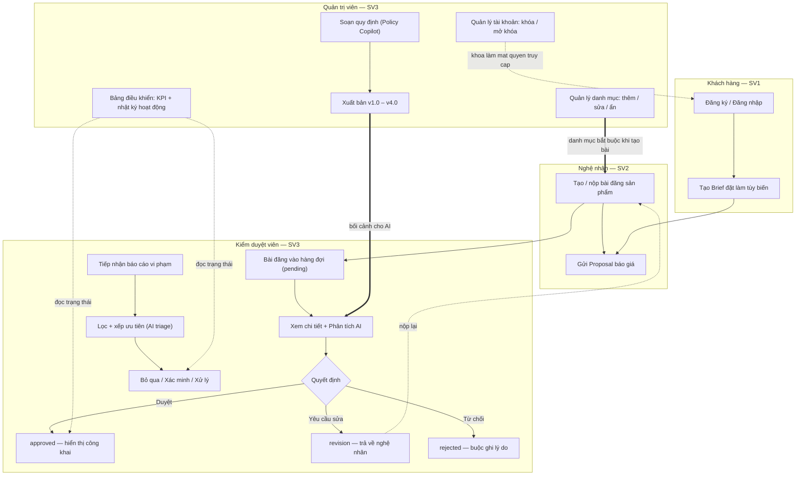

# Sơ đồ User Flow — CraftLink

Barem yêu cầu ở đâu: ĐK1 — "Đã có Bảng kiểm kê màn hình (`docs/screen-inventory.md`) + **Sơ đồ User Flow** + Thiết kế Figma/Canva"; Tiêu chí 1.2 đánh giá "Luồng người dùng (User Flow) & Bảng kiểm kê màn hình".

Bản render độ phân giải cao để đưa vào slide: `diagrams/user-flow-sv3-forest.png` (hoặc `.svg` để phóng to không vỡ). Mã nguồn sơ đồ là `diagrams/user-flow-sv3.mmd` — sửa tệp đó rồi chạy `node diagrams/render.mjs` để tái tạo ảnh.

## Luồng xuyên vai trò

## Bốn cạnh nối chứng minh các màn hình không rời rạc

| Cạnh | Ý nghĩa nghiệp vụ | Màn hình hai đầu |
|---|---|---|
| Khách tạo Brief → Nghệ nhân gửi Proposal | Vòng đời đơn tùy biến khép kín giữa hai vai trò | STT 3 → STT 9–10 |
| Nghệ nhân nộp bài → bài vào hàng đợi `pending` | Bài đăng không tự ra thị trường, phải qua kiểm duyệt | STT 7–8 → STT 14 |
| Quản trị viên xuất bản quy định → hàng đợi dùng quy định làm căn cứ | Chính sách nội dung là dữ liệu đầu vào của kiểm duyệt, kể cả đầu vào prompt AI | STT 18 → STT 14 |
| Quản trị viên khóa tài khoản → khách/nghệ nhân mất quyền truy cập | Phân quyền tác động trực tiếp lên hai vai trò kia | STT 17 → STT 1, 7 |

Nhãn trạng thái `pending / approved / revision / rejected` là giá trị thật trong mã, không phải ký hiệu tự đặt; xem `KiemDuyetVaQuanTri/04-moderation-queue/js/main.js` (hàm `render`, bảng `statusNames`).

## Phần chưa hoàn thành

- Nhãn màn hình ở lane SV1 và SV2 lấy theo `docs/screen-inventory.md` bản hiện tại; SV1 và SV2 phải xác nhận lại tên thật sau khi đưa mã nguồn vào `pages/`.
- Bản thiết kế đi kèm: Canva của nhóm và Canva sáu màn hình quản trị (liên kết ở `../README.md`, mục LIÊN KẾT).
